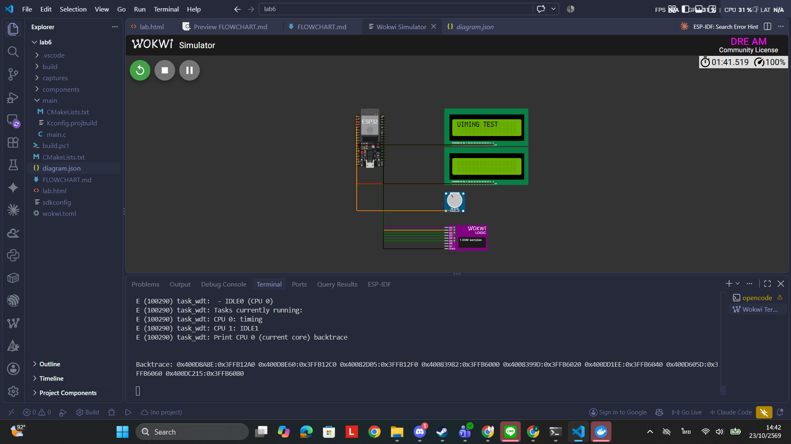
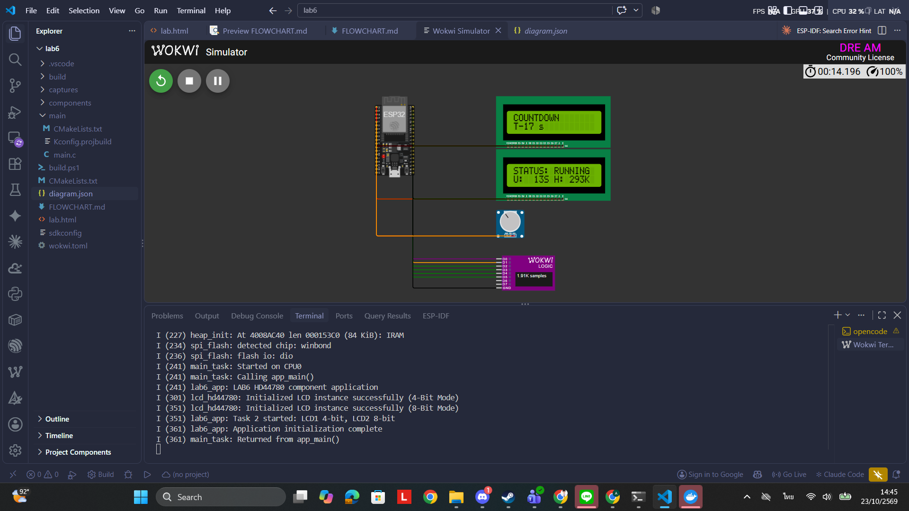
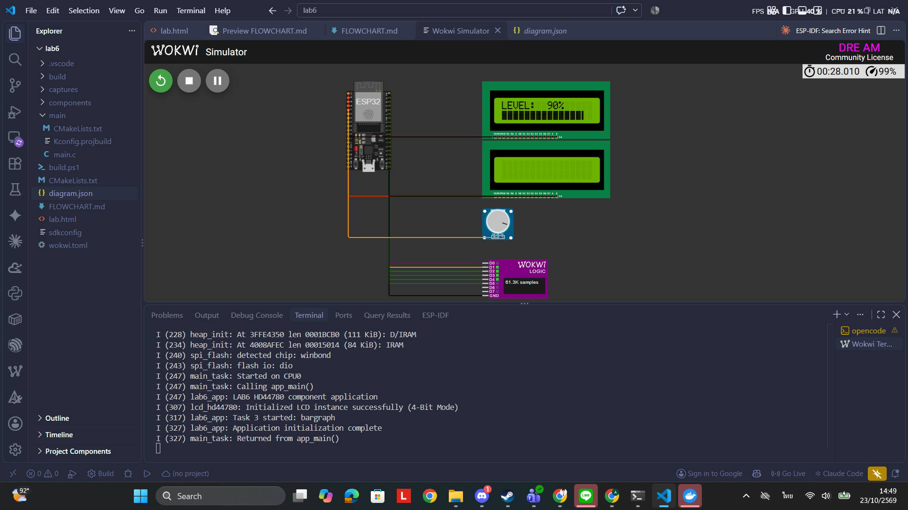
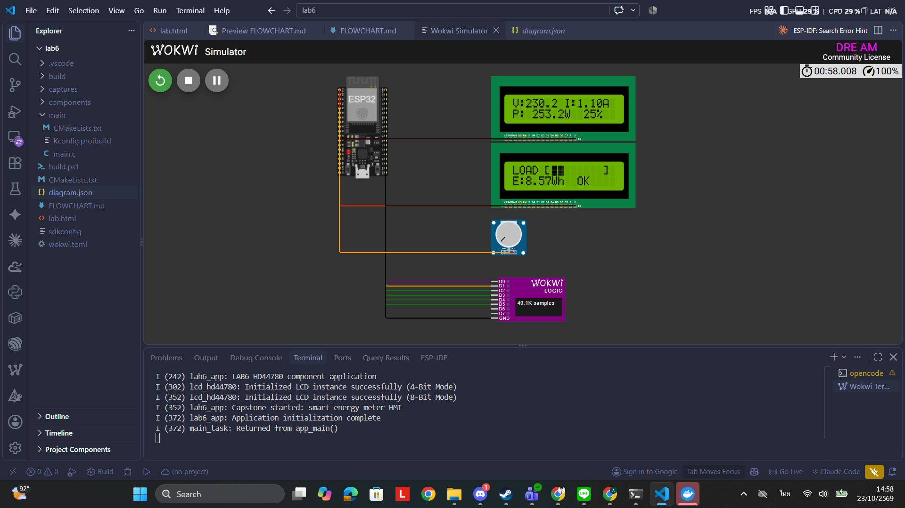
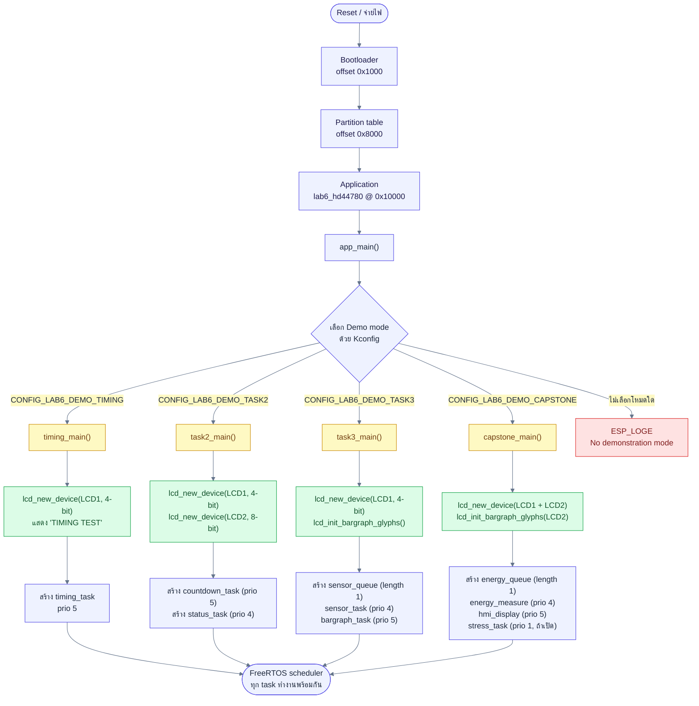
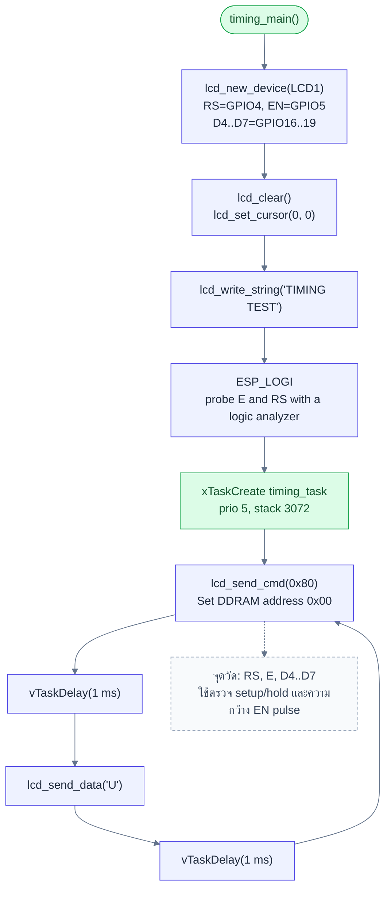
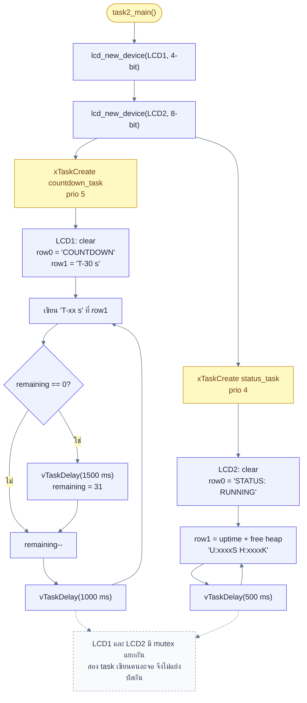
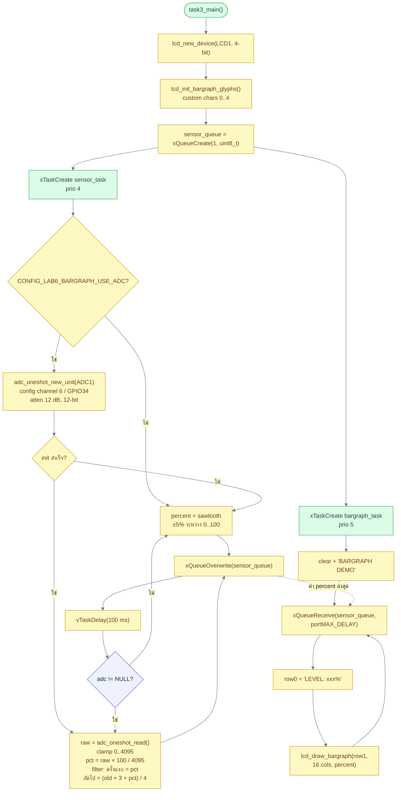
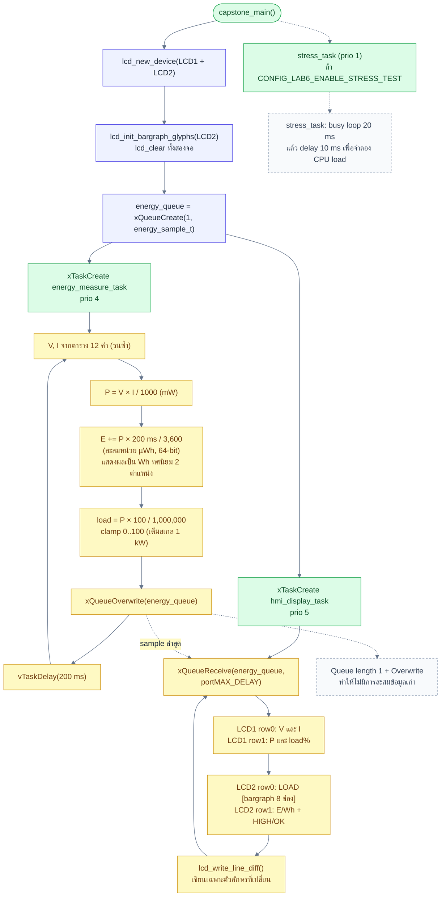

# LAB6 — รายงานผลการทดลองและคู่มือเก็บภาพหลักฐาน

เอกสารนี้ใช้สำหรับเก็บภาพหลักฐานของแต่ละภารกิจใน LAB6 พร้อม flowchart ที่ตรงกับโค้ดจริง
ใช้คู่กับ `lab.html` (ใบงาน), `FLOWCHART.md` (แผนภาพ), `diagram.json` (วงจร Wokwi) และ `main/main.c`

## 1. ข้อมูลโปรเจกต์

| รายการ | ค่า |
|---|---|
| บอร์ดจำลอง | `board-esp32-devkit-c-v4` (Wokwi for VS Code) |
| MCU | ESP32, target `esp32` |
| LCD1 | HD44780 โหมด 4-bit: RS=GPIO4, EN=GPIO5, D4–D7=GPIO16–19, RW=GND |
| LCD2 | HD44780 โหมด 8-bit: RS=GPIO13, EN=GPIO14, D0–D7=GPIO32,33,25,26,27,21,22,23, RW=GND |
| Sensor | Potentiometer 10k ต่อ GPIO34 (ADC1 channel 6), ปลายไว้ที่ 3V3/GND |
| Logic Analyzer | D0=RS, D1=E, D2–D5=D4–D7, GND ร่วมกับบอร์ด |
| Toolchain | ESP-IDF v6.1 |
| Build | `.\build.ps1 build` (หรือ `.\build.ps1 menuconfig`) |
| Simulator | Wokwi for VS Code: `F1` → `Wokwi: Start Simulator` / `Stop Simulator` |
| Firmware | `build/lab6_hd44780.bin`, `build/lab6_hd44780.elf` |

## 2. สรุปสถานะงานและภาพที่ต้องเก็บ

| ลำดับ | งาน | โหมดที่ใช้ | สถานะผล | หลักฐานที่มี | ภาพที่ต้องเก็บ |
|---|---|---|---|---|---|
| 1 | Hardware Timing Verification | `TIMING` | ผ่าน (วิเคราะห์ VCD จริง) | `captures/task1-timing.vcd` | `img/p1.png` |
| 2 | Dual-Instance Mixed Mode | `TASK2` | ผ่าน (ผลรันยืนยันแล้ว) | คำอธิบายผลรัน | `img/p2.png` |
| 3 | Analog Bargraph | `TASK3` + ADC | ผ่าน (ผลรันยืนยันแล้ว) | คำอธิบายผลรัน | `img/p3.png` |
| 4 | Capstone: Smart Energy Meter HMI | `CAPSTONE` + stress | ผ่าน (ผลรันยืนยันแล้ว) | คำอธิบายผลรัน | `img/pall.png` |
| 5 | คำถามท้ายบท | — | ตอบแล้ว | หัวข้อ 10 | ไม่ต้องใช้ภาพ |

> firmware ปัจจุบันที่ build ไว้คือ `CAPSTONE` ถ้าจะเก็บภาพภารกิจก่อนหน้า ต้องสลับโหมดแล้ว build ใหม่ทุกครั้ง

## 3. กติกาการถ่ายภาพหน้าจอ

1. ใช้ `Win + Shift + S` หรือ Snipping Tool และบันทึกเป็นไฟล์ `.png`
2. เก็บภาพ **ทั้งหน้าต่าง Wokwi** ให้เห็นบอร์ด, LCD ทั้งสองจอ (ถ้ามี), potentiometer และ Serial Monitor ในภาพเดียว
3. ต้องเห็นข้อความใน Serial Monitor ชัดเจน เพื่อยืนยันว่า firmware ที่รันตรงกับโหมดของภารกิจ
4. ตั้ง zoom ของ VS Code ที่ 100% และขยายหน้าต่าง Wokwi ให้ข้อความ LCD อ่านได้ก่อนแคป
5. ห้ามใช้ภาพ mockup หรือภาพตัดต่อ; ใช้ผลรันจริงเท่านั้น
6. ตั้งชื่อไฟล์ตามตารางในหัวข้อ 2 และเก็บไว้ที่ `img/`
7. ภาพระยะใกล้ (ถ้าทำ) ให้ตั้งชื่อเพิ่ม เช่น `p1-close.png` และต้องมีภาพรวมคู่กันเสมอ
8. สำหรับภารกิจ 1 ให้แคปทั้งหน้า Wokwi ขณะรัน และภาพคลื่นจาก VCD ในโปรแกรมดูรูปคลื่น (PulseView/GTKWave)
9. ไม่ต้องแคปหน้าจอ license, อีเมล หรือข้อมูลส่วนตัว
10. หลัง Stop Simulator ให้ตรวจว่าไฟล์ VCD ถูกเขียนลง `captures/` ก่อนปิด VS Code

### ตำแหน่งไฟล์ภาพ

```
img/
├── p1.png      (ภารกิจ 1 — ภาพรวม Wokwi)
├── p2.png      (ภารกิจ 2 — LCD1 + LCD2)
├── p3.png      (ภารกิจ 3 — Bargraph)
└── pall.png    (Capstone — ภาพรวม)
```

## 4. วิธีสลับโหมดและรัน

### 4.1 เลือกโหมด

```powershell
.\build.ps1 menuconfig
```

ไปที่ `LAB6 HD44780 Lab` → `Select demonstration mode` แล้วเลือกโหมดที่ต้องการ

| ภารกิจ | ตัวเลือกใน menuconfig | ค่าใน `sdkconfig` |
|---|---|---|
| 1 | Task 1 - Enable timing signal test | `CONFIG_LAB6_DEMO_TIMING=y` |
| 2 | Task 2 - Dual-instance 4-bit and 8-bit LCD | `CONFIG_LAB6_DEMO_TASK2=y` |
| 3 | Task 3 - Analog bargraph | `CONFIG_LAB6_DEMO_TASK3=y` |
| 4 | Capstone - Smart energy meter HMI | `CONFIG_LAB6_DEMO_CAPSTONE=y` |

สำหรับภารกิจ 3 ต้องเปิด `Task 3 - Read ADC sensor on GPIO34` เพิ่ม (`CONFIG_LAB6_BARGRAPH_USE_ADC=y`)
สำหรับ Capstone ให้เปิด `Capstone - Enable high-load stress task` (`CONFIG_LAB6_ENABLE_STRESS_TEST=y`)

### 4.2 ตั้งไฟล์ VCD ต่อภารกิจ

แก้ `wokwi.toml` ก่อนรัน เพื่อไม่ให้ไฟล์ของแต่ละงานทับกัน

| ภารกิจ | ค่า `vcdFile` |
|---|---|
| 1 | `captures/task1-timing.vcd` |
| 2 | `captures/task2-dual.vcd` |
| 3 | `captures/task3-bargraph.vcd` |
| 4 | `captures/capstone-hmi.vcd` |

ตัวอย่าง:

```toml
[wokwi]
version = 1
elf = "build/lab6_hd44780.elf"
firmware = "build/flasher_args.json"
gdbServerPort = 3333
vcdFile = "captures/task1-timing.vcd"
```

### 4.3 Build และรัน

```powershell
.\build.ps1 build
```

1. เปิดโฟลเดอร์ `lab6` ใน VS Code
2. กด `F1` → `Wokwi: Start Simulator`
3. รอให้ LCD แสดงผลตามที่กำหนดในแต่ละภารกิจ
4. กด `F1` → `Wokwi: Stop Simulator` (ต้อง Stop เพื่อให้ Wokwi เขียนไฟล์ VCD)

## 5. ภารกิจ 1 — Hardware Timing Verification

### 5.1 สิ่งที่ต้องเตรียม

- โหมด `TIMING`, LCD1 ต่อแบบ 4-bit
- Logic Analyzer ต่อ D0=RS, D1=E, D2–D5=D4–D7, GND ร่วมกับบอร์ด
- ตั้ง `vcdFile = "captures/task1-timing.vcd"`

### 5.2 ขั้นตอนเก็บภาพ

1. Start Simulator แล้วรอจน LCD1 แสดง `TIMING TEST` และ Serial แสดง `Task 1 started: probe E and RS with a logic analyzer`
2. รออย่างน้อย 3 วินาที ให้ logic analyzer มี sample เพิ่มขึ้น
3. แคปภาพทั้งหน้าต่าง Wokwi เป็น `img/p1.png` (ต้องเห็น LCD, logic analyzer และ Serial)
4. Stop Simulator แล้วตรวจว่าได้ `captures/task1-timing.vcd`
5. เปิด VCD ด้วย PulseView หรือ GTKWave:
   - PulseView: `Open` → ลูกศรข้างปุ่ม Open → `Import Value Change Dump data...`
   - ตั้ง Downsampling factor = 50
6. ซูมให้เห็น E, RS และ D4–D7 อย่างน้อย 3–4 byte แล้วแคปเป็น `img/p1-waveform.png` (ถ้าต้องการ)
7. ถ้าใช้ marker วัดใน PulseView ให้วาง marker ที่ขอบ rising/falling ของ E และอ่านค่าเป็น ns

### 5.3 ภาพที่ต้องมี

- [x] `img/p1.png` — ภาพรวม Wokwi ขณะรันโหมด TIMING



### 5.4 สูตรที่ใช้คำนวณ

กำหนด timescale ของ VCD = 1 ns

- `t_PWE` = เวลาที่ E เป็น high = `t_fall(E) - t_rise(E)`
- `t_cycE` = ระยะระหว่าง rising edge ของ E ที่ติดกัน = `t_rise(E, n+1) - t_rise(E, n)`
- `t_DSW` = ระยะจากข้อมูล D4–D7 นิ่งครั้งสุดท้ายถึง rising edge ของ E

ตัวอย่างจาก VCD จริง:

```
t_PWE  = 476080550 - 476073675 = 6,875 ns
t_cycE = 476162300 - 476073675 = 88,625 ns
t_DSW  = 476162300 - 476154800 = 7,500 ns
```

### 5.5 ผลวิเคราะห์จาก `captures/task1-timing.vcd`

ข้อมูล: 388 EN pulses, 387 cycles, LCD1 โหมด 4-bit, จับ E/RS/D4–D7 ครบ

| พารามิเตอร์ | Datasheet | ค่าที่วัดได้ (min / median / max) | เกณฑ์ | ผล |
|---|---|---|---|---|
| `t_PWE` | ≥ 450 ns | 2,000 / 6,875 / 6,875 ns | ต้องไม่น้อยกว่า 450 ns | ผ่าน |
| `t_cycE` | ≥ 1,000 ns | 79,981 / 88,625 / 245,875 ns | ต้องไม่น้อยกว่า 1,000 ns | ผ่าน |
| `t_DSW` | ≥ 195 ns | 7,500 / 18,000 / 375,300 ns | ต้องไม่น้อยกว่า 195 ns | ผ่าน |

หมายเหตุ:

- `t_PWE` ปกติ 6,875 ns จำนวน 380 pulse; มี 8 pulse ที่ชายขอบรอบอัปเดตสั้นลงเหลือ 2.0–2.24 µs แต่ยังผ่านเกณฑ์
- `t_cycE` ที่เห็น ~997 ms คือช่วงพักระหว่างการอัปเดตนับถอยหลัง 1 วินาที ไม่ใช่ cycle ของการเขียน byte
- ค่าที่วัดได้สูงกว่าขั้นต่ำของ datasheet มาก แสดงว่า driver มี margin ด้าน timing ปลอดภัย

### 5.6 เกณฑ์ผ่านภารกิจ 1

- [ ] `t_PWE` ≥ 450 ns
- [ ] `t_cycE` ≥ 1,000 ns
- [ ] มีภาพรวมการรันและภาพคลื่นจาก VCD
- [ ] อธิบายได้ว่าค่าที่วัดได้สูงกว่าขั้นต่ำเท่าใด

> ไฟล์ VCD ที่มีอยู่เก็บจากการเขียน LCD1 โหมด 4-bit (Task 2) จึงใช้วิเคราะห์ timing ของ driver ได้
> หากอาจารย์ต้องการ capture จากโหมด `TIMING` โดยเฉพาะ ให้สลับโหมดแล้วรันใหม่ตามหัวข้อ 4

## 6. ภารกิจ 2 — Dual-Instance Mixed Mode

### 6.1 สิ่งที่ต้องเตรียม

- โหมด `TASK2`
- ตั้ง `vcdFile = "captures/task2-dual.vcd"`
- LCD1 แสดง countdown, LCD2 แสดงสถานะระบบ

### 6.2 ขั้นตอนเก็บภาพ

1. Start Simulator
2. รออย่างน้อย 3 วินาที ให้ LCD2 อัปเดต uptime/heap หลายรอบ
3. ขณะ LCD1 ยังนับอยู่ในช่วง `T-30 s` ถึง `T-20 s` ให้แคปทั้งหน้าต่างเป็น `img/p2.png`
4. ถ้าต้องการภาพระยะใกล้ ให้แคปเพิ่มเป็น `img/p2-lcd1.png` และ `img/p2-lcd2.png`
5. Stop Simulator

### 6.3 ผลที่ต้องเห็น

LCD1:

```
COUNTDOWN
T-30 s   (นับลดถึง T-00 s แล้ววนใหม่)
```

LCD2:

```
STATUS: RUNNING
U:xxxxS H:xxxxK   (อัปเดตทุก 0.5 วินาที)
```

Serial ที่ต้องมี:

```
lcd_hd44780: Initialized LCD instance successfully (4-Bit Mode)
lcd_hd44780: Initialized LCD instance successfully (8-Bit Mode)
lab6_app: Task 2 started: LCD1 4-bit, LCD2 8-bit
lab6_app: Application initialization complete
```

### 6.4 ภาพที่ต้องมี

- [x] `img/p2.png` — เห็น LCD1 + LCD2 + Serial พร้อมกัน



### 6.5 เกณฑ์ผ่านภารกิจ 2

- [ ] LCD1 นับถอยหลังถูกต้องและวนใหม่
- [ ] LCD2 แสดง uptime และ free heap ต่อเนื่อง
- [ ] ทั้งสองจอทำงานพร้อมกันโดยไม่เพี้ยนหรือกระพริบ
- [ ] Serial แสดงโหมด 4-Bit และ 8-Bit ครบ

## 7. ภารกิจ 3 — Analog Bargraph

### 7.1 สิ่งที่ต้องเตรียม

- โหมด `TASK3`
- เปิด `CONFIG_LAB6_BARGRAPH_USE_ADC=y`
- ตั้ง `vcdFile = "captures/task3-bargraph.vcd"`
- Potentiometer ต่อ GPIO34; ค่าเริ่มต้น 512 (~50%)

### 7.2 ขั้นตอนเก็บภาพ

1. Start Simulator แล้วรอให้ LCD1 แสดง `BARGRAPH DEMO`
2. หมุน pot ไปตำแหน่งที่ต้องการ รอประมาณ 1 วินาที แล้วแคปเป็น `img/p3.png`
3. ถ้าต้องการแสดงครบทุกช่วง ให้แคปเพิ่มเป็น `img/p3-0pct.png`, `img/p3-50pct.png`, `img/p3-100pct.png`
5. ทุกภาพต้องเห็น Serial Monitor และ LCD ในภาพเดียวกัน
6. Stop Simulator

### 7.3 ผลที่ต้องเห็น

- LCD1 บรรทัดบน: `LEVEL:   0%` → `LEVEL:  50%` → `LEVEL: 100%`
- LCD1 บรรทัดล่าง: bargraph 16 คอลัมน์
  - 0% = ว่าง
  - 50% = เต็มประมาณ 8 คอลัมน์
  - 100% = เต็ม 16 คอลัมน์
- ค่าที่อ่านได้อาจคลาดเคลื่อน ±1% จากการแบ่งแรงดันของ pot
- Serial:

```
lab6_app: Task 3 started: bargraph
lab6_app: Application initialization complete
```

### 7.4 ภาพที่ต้องมี

- [x] `img/p3.png` — ภาพ Bargraph



### 7.5 เกณฑ์ผ่านภารกิจ 3

- [ ] ค่า `LEVEL` เปลี่ยนตามการหมุน pot
- [ ] จำนวนคอลัมน์ของ bargraph สอดคล้องกับเปอร์เซ็นต์
- [ ] ไม่มีข้อความค้างหรือสัญลักษณ์ผิดตำแหน่ง
- [ ] ใช้ ADC จริง ไม่ใช่ waveform จำลอง

## 8. Capstone — Smart Energy Meter HMI

### 8.1 สิ่งที่ต้องเตรียม

- โหมด `CAPSTONE`
- เปิด `CONFIG_LAB6_ENABLE_STRESS_TEST=y`
- ตั้ง `vcdFile = "captures/capstone-hmi.vcd"`

### 8.2 ขั้นตอนเก็บภาพ

1. Start Simulator
2. รอประมาณ 1 วินาที (ช่วงโหลดต่ำ) แล้วแคปเป็น `img/pall.png`
   - ต้องเห็น LCD1, LCD2, Serial และค่า `OK`
3. รอจน waveform มาถึงช่วงโหลดสูง (ประมาณ 1.4–1.8 วินาทีต่อรอบ) แล้วแคปเพิ่มเป็น `img/pall-high.png` (ถ้าต้องการ)
   - ต้องเห็นสถานะ `HIGH` และ bargraph ยาวขึ้น
4. สังเกตว่าจอไม่กระพริบขณะ stress task ทำงาน
5. Stop Simulator

### 8.3 ผลที่ต้องเห็น

LCD1:

```
V:229.8 I:0.85A
P: 195.3W  19%
```

LCD2:

```
LOAD [■■■■    ]
E:0.01Wh  OK
```

ค่าจะเปลี่ยนตาม waveform 12 สเต็ป (รอบละ 200 ms):

| ช่วง | กระแส | กำลัง | Load | สถานะ |
|---|---|---|---|---|
| เริ่มต้น | 0.85 A | ~195 W | 19% | OK |
| กลางรอบ | 2.0–2.8 A | ~460–645 W | 46–64% | OK |
| โหลดสูง | 3.8–4.0 A | ~875–922 W | 87–92% | HIGH |

- พลังงาน `E` สะสมเพิ่มขึ้นเรื่อย ๆ (หน่วย Wh, ทศนิยม 2 ตำแหน่ง)
- Serial:

```
lab6_app: Capstone started: smart energy meter HMI
lab6_app: Application initialization complete
```

### 8.4 ภาพที่ต้องมี

- [x] `img/pall.png` — ภาพรวม Capstone



### 8.5 เกณฑ์ผ่าน Capstone

- [ ] LCD1 แสดง V, I, P และ load% ครบ
- [ ] LCD2 แสดง bargraph, พลังงานสะสม และสถานะ HIGH/OK
- [ ] ค่าเปลี่ยนแปลงตาม waveform และพลังงานสะสมเพิ่มขึ้น
- [ ] ไม่มี flicker แม้ stress task ทำงาน
- [ ] Serial ไม่มี error

## 9. Flowchart

แผนภาพทั้งหมดอ้างอิงจาก `main/main.c` และตรงกับโค้ดที่ build จริง
เปิดดูแบบ interactive ได้ใน `FLOWCHART.md` ด้วย `Ctrl+Shift+V`
ต้องติดตั้งส่วนขยาย `bierner.markdown-mermaid` (มีแนะนำไว้ใน `.vscode/extensions.json`)

### 9.1 ภาพรวม: Boot → app_main → เลือกโหมด



### 9.2 ภารกิจ 1: Hardware Timing Verification



### 9.3 ภารกิจ 2: Dual-Instance Mixed Mode



### 9.4 ภารกิจ 3: Analog Bargraph



### 9.5 Capstone: Smart Energy Meter HMI



## 10. คำถามท้ายบท (สรุปคำตอบ)

1. **Opaque handle:** `typedef struct lcd_hd44780_t *lcd_handle_t;` ใน header ทำให้ผู้ใช้เห็นเพียง pointer ไม่เห็น layout ภายใน จึงแก้ไข struct ได้โดยไม่ต้อง recompile โค้ดผู้ใช้, ป้องกันการเข้าถึง field ตรง ๆ และรองรับหลายอินสแตนซ์
2. **ส่ง `0x03` สามครั้ง:** เป็นลำดับ init มาตรฐานของ HD44780 เพื่อบังคับให้คอนโทรลเลอร์เข้าสู่สถานะ 8-bit ที่รู้แน่ชัดก่อน แล้วจึงส่ง `0x02` เพื่อเปลี่ยนเป็น 4-bit; หากข้ามขั้นตอนนี้ คอนโทรลเลอร์อาจอยู่สถานะไม่ตรงและรับคำสั่งไม่ได้
3. **Mutex และ thread-safety:** mutex ต่อ LCD หนึ่งตัวทำให้ธุรกรรมของ task หนึ่งเขียนจบก่อน task อื่นจึงเริ่ม ลดการแทรกกลางลำดับคำสั่ง; LCD คนละตัวมี mutex แยกกันจึงทำงานขนานได้
4. **รองรับ I2C/PCF8574:** เพิ่ม bus type ใน `lcd_config_t` และแยกชั้น transport (GPIO ตรง vs I2C expander) โดยคง API เดิม; PCF8574 จะ map RS/RW/E/D4–D7 ผ่าน I2C แทนการใช้ GPIO โดยตรง

## 11. Checklist ก่อนส่ง

- [ ] build ผ่านและมี `build/lab6_hd44780.bin`
- [x] ภาพครบตามหัวข้อ 2 และอยู่ใน `img/`
- [ ] ภาพภารกิจ 1 มีทั้งหน้า Wokwi และ waveform จาก VCD
- [ ] ภาพภารกิจ 3 มี 3 ระดับ (0/50/100%)
- [ ] ภาพ Capstone มีทั้งสถานะ OK และ HIGH
- [ ] flowchart ในหัวข้อ 9 ตรงกับโค้ดจริง
- [ ] คำถามท้ายบทตอบครบ 4 ข้อ
